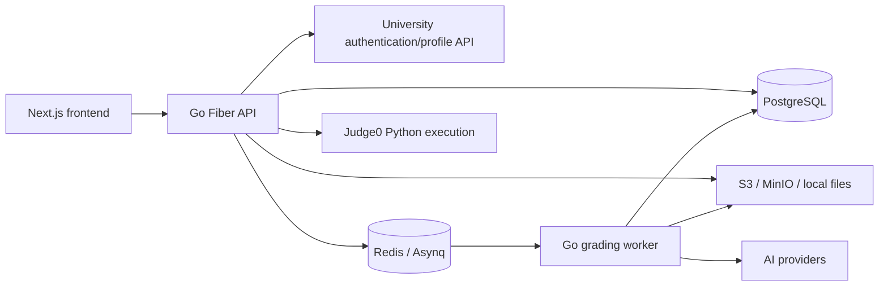

# Architecture reference

Source reviewed: 2026-10-24. This describes the current implementation, not a new
architecture or a verified deployment. Use the [setup guide](../README.md) for
commands, [quality baseline](quality-baseline.md) for executed checks, and
[domain rules](domain-rules.md) for behavior and unresolved decisions.

## Runtime and module boundaries

| Responsibility | Source entry point |
| --- | --- |
| Frontend routes and layout | [frontend/src/app](../frontend/src/app); login, courses/members/assignments/summary, templates, attachments, AI settings/jobs |
| Client authentication | [auth-context.tsx](../frontend/src/lib/auth-context.tsx); login response stored under localStorage `user`, bearer token sent by components |
| API bootstrap | [cmd/server/main.go](../backend/cmd/server/main.go); config, logging, DB, storage, queue, Fiber middleware, router |
| Routing / access context | [router.go](../backend/internal/router/router.go), [middleware.go](../backend/internal/middleware/middleware.go); `user_id`, global `user_role`, course `course_role` |
| HTTP / business / persistence | [handler](../backend/internal/handler), [service](../backend/internal/service), [repository](../backend/internal/repository); package-level functions over shared DB/storage/queue handles |
| Database initialization | [postgres.go](../backend/internal/database/postgres.go); both API and worker run GORM AutoMigrate at startup |
| Worker and task contract | [cmd/worker/main.go](../backend/cmd/worker/main.go), [queue](../backend/internal/queue), [worker](../backend/internal/worker) |
| External integrations | [storage](../backend/internal/storage), [ai](../backend/internal/ai), [run_service.go](../backend/internal/service/run_service.go), [auth_service.go](../backend/internal/service/auth_service.go) |
| Deployment/log definitions | [primary Compose](../docker/docker-compose.yml), [logger](../backend/internal/logger), [middleware](../backend/internal/middleware); runtime verification remains incomplete |

Pages/components call the Go API directly using `NEXT_PUBLIC_API_URL`. Authentication
and screen state use React context/local state; this is not a Next.js API-route or
server-action backend. Frontend DTOs and fetch handling are handwritten in multiple
components. Client redirects and hidden controls do not enforce server permission.

The Go layering is useful but not a strict dependency-injection boundary:
middleware queries the DB, and services/workers call storage and queue packages.
Preserve these boundaries while making focused changes; an interface redesign is
not required to work on the current app.

## Persistence map

Canonical definitions: [models.go](../backend/internal/models/models.go). Treat
GORM relationships as source declarations; the live schema has not been inspected.

New uploads use random UUID object keys from [key.go](../backend/internal/storage/key.go)
across all storage adapters. `Attachment.FileName` keeps the original display name;
read/delete paths use the persisted `FileKey`, including existing timestamp keys.

| Models | Relationship / ownership |
| --- | --- |
| `User`, `Course`, `CourseMember` | Course has a teacher and section metadata; membership links users to courses with role/status |
| `Assignment`, `AssignmentOverride` | Assignment belongs to one course; override links an assignment/student to an extended deadline |
| `Submission`, `Comment` | Submission links assignment/student and an optional attachment; nullable score/grading role; comments link to submission and author/role |
| `Attachment`, `Tag` | Attachment records uploader and private storage key; assignments/templates share attachments and tags through many-to-many joins |
| `AssignmentTemplate` | Owned by `CreatedBy`; reusable assignment content with attachments/tags and optional AI config/prompt |
| `AICredential`, `AIConfig`, `PromptTemplate` | User-owned AI settings; config references encrypted provider credentials; saved prompts are separate records |
| `GradingJob` | Assignment/teacher job record with status, progress, counts, timestamps, and error; unique assignment/teacher pair |

Join tables are `assignment_attachments`, `assignment_tags`,
`assignment_template_attachments`, and `assignment_template_tags`. Course-member,
assignment-override, and student/assignment submission pairs do not have composite
uniqueness declarations. Submission attempts and selection policy remain open.
There is no persisted text-answer or submission-status column.

## Compact API contract map

All paths below start with `/api`. Define `C = /courses/:course_id`,
`A = C/assignments/:assignment_id`, and `S = A/submissions/:submission_id`.
These abbreviations are documentation only. Routes are registered in the
[router](../backend/internal/router/router.go) and linked handler directories above.
Protected routes require `Authorization: Bearer <token>`; course routes also pass
active-membership middleware. Endpoint-specific permission and scoping gaps remain.

| Method / path | Request -> response / effect |
| --- | --- |
| `POST /auth/login` | JSON `username,password` -> token, username, English/Thai names, global role; university authentication and local user creation/update |
| `GET /me` | Current-user/profile data; see [me_service.go](../backend/internal/service/me_service.go) |
| `GET, POST /courses`; `GET, PUT, DELETE C` | Course JSON fields -> course data; teacher membership created with new course |
| `POST C/enroll`; `GET C/members`; `PUT, DELETE C/members/:member_id` | Enrollment `user_enroll:[{username,course_role}]`; update `new_role,new_status`; `member_id` is a user ID |
| `GET, POST C/assignments`; `PUT, DELETE A` | Create/update multipart `title,description,point,start,due,close,visible,tags,attachments,files,ai_config_id,prompt`; list returns `{role,assignments}` |
| `GET A`; `GET A/summary` | Detail returns `{role,assignment,submissions}`; summary returns `{statistic,submission_list}` |
| `POST A/override` | JSON `student_id,extended_due_date` -> override record |
| `POST A/submissions`; `PUT S`; `GET S/read` | Multipart `file` -> submission DTO; read returns a JSON string with stored text |
| `PUT S/grade`; `PUT S/grade-with-comment` | JSON `point`, optionally `comment,visible` -> updated grading fields |
| `POST, POST /:comment_id` under `S/comment` | Upsert comment using `comment,visible`; second route toggles visibility |
| `GET, POST /attachments`; `GET, DELETE /attachments/:id`; `GET /attachments/:id/download` | Upload repeated multipart `files`; owned list/detail; download sends bytes and attachment headers |
| `GET, POST /templates`; `GET /templates/short`; `GET, PUT, DELETE /templates/:id` | Reusable template forms/content, scoped by creator in repositories |
| `POST /run/python3` | JSON `source_code,stdin` -> `stdout,stderr,status,time,memory`; global execution permission |
| `GET A/auto-grading`; `GET /ai/jobs`; `DELETE /ai/jobs/:id` | **GET starts work** and returns a message; job list is `{jobs:[...]}`; completed/failed jobs can be deleted |
| `/ai`, `/ai/configs/...`, `/ai/:credential_id/models`, `/ai/prompts` | Credential/config/prompt CRUD and model discovery; see [ai_handler.go](../backend/internal/handler/ai_handler.go) for exact methods and paths |
| `GET C/assignments/export`; `GET A/export`; `GET A/submissions/download` | CSV score exports / ZIP submission download; staff permission checks |

[forms.go](../backend/internal/models/forms.go),
[response.go](../backend/internal/models/response.go), and
[convertor.go](../backend/internal/models/convertor.go) are the contract source.
Request dates use `start,due,close`; response dates use
`start_date,due_date,close_date` and currently lose time/timezone precision.
Submission `point`, `graded_by`, `attachment_id`, and `file_name` can be null.
The DTO's `answer` field does not establish persisted text-answer support.

[SendError](../backend/internal/handler/handler.go) maps application errors to
`{error:message}`, defaulting unknown errors to 500. Some handlers/middleware return
Fiber errors directly, so not every failure shares that JSON contract.

## Critical data paths

1. **Authenticate:** university verification -> find/create local user -> sign JWT
   -> browser storage -> middleware reloads the user and active course role.
2. **Create/reuse assignment:** dialog/template selection -> multipart form ->
   service resolves owned attachments/tags -> course assignment. Template use is
   per-course creation; there is no dedicated multi-section distribution endpoint.
3. **Submit/read:** multipart file -> storage object + attachment row -> submission
   -> detail DTO/read/download. See [submission service](../backend/internal/service/submission_service.go).
   Nested submission actions first pass active-course membership, then
   [submission middleware](../backend/internal/middleware/submission.go), which
   binds the submission to both URL parents. Handler permissions use the course
   role; student reads/updates retain ownership checks. This HTTP guard covers
   read, update, grading, and comments; ID-only service/repository helpers are not
   independently authorized entry points. Creation and assignment ZIP download
   keep their existing assignment-scoped checks. Standalone attachment downloads
   remain separate R10 work.
   Replacement stages bytes before a transaction that creates attachment metadata,
   updates the owner-scoped reference, and reloads the response. Old bytes/records
   are retained; fileless updates detach only. This path never deletes storage and
   does not change grades/comments. Retained-file cleanup is separate work.
   R8 checks visible assignments against inclusive start/effective close before
   upload. [Deadline helpers](../backend/internal/models/deadlines.go) calculate
   extended due and `max(original close, extended due)` for admission and DTOs.
   Assignment schedule DTOs contain full UTC timestamps; UI display/edit uses
   Asia/Bangkok through `frontend/src/lib/datetime.ts`.
4. **Grade/report:** manual score/comment writes or worker writes -> PostgreSQL ->
   summary/export. See [summary helpers](../backend/internal/service/service.go).
   R8 preloads current attachments and loads assignment overrides in one query.
   Summary and CSV select the latest current file per student using attachment
   `CreatedAt`; per-student due determines lateness independently of grading.
   Missing historical upload times are reported explicitly, without a backfill.
5. **AI job:** assignment service creates/resets job -> Asynq payload
   `{assignment_id,teacher_id,force_regrade}` -> worker loads attached submissions,
   decrypts provider key, reads files, batches ten answers, calls provider,
   normalizes results, writes scores/comments and progress. Worker concurrency is
   three. [AI persistence](../backend/internal/repository/ai_grade_repository.go)
   saves score and AI feedback in one conditional transaction: normal jobs fill
   entirely ungraded rows; forced jobs may also replace AI-attributed work. Human
   grades are protected at write time, including after provider calls. Forced jobs
   retain previous AI output until replacement commits; there is no broad pre-reset.
   Existing AI comments are updated in place.
   Mapping validates the full batch before persistence: explicit unique indexes,
   exact count, and agreement with any optional IDs are required. The JSON boundary
   rejects absent/null indexes and duplicate properties; there is no order fallback.
   Queue enqueue sets max retries to three. The raw `Timeout(60)` option needs
   duration-unit verification under R12; do not describe it as 60 seconds.
6. **Run Python:** API sends base64 code/input to Judge0 with Python language ID 71,
   resource limits and `enable_network=false`; HTTP timeout is ten seconds.

DB job status and Asynq execution state are separate; they are not guaranteed to
stay synchronized. File, database, queue, and provider operations also do not form
one transaction. Follow R1-R13/O1-O4 in the [checklist](development-checklist.md)
before relying on permission, preservation, or grading guarantees.

Keep this map short and update the affected entry when a contract or boundary
changes. No ADR is introduced here: documenting existing code does not decide a
new architecture or unresolved domain policy.

AI config editing carries the URL config ID from handler through service into the
repository's owner+ID update predicate; zero matches return config-not-found.
Credential ownership is still validated separately and update field behavior is
unchanged. See [AI service](../backend/internal/service/ai_service.go) and
[AI queries](../backend/internal/repository/ai_repository.go).

R9 validates input before mutation through `models/validation.go` and
`service/validation.go`: date/point transport fields distinguish omission from
explicit zero; attachment batches are preflighted before uploads; optional AI
references are owned. `repository/grade_bounds.go` serializes grade writes and
assignment edits using an assignment row lock, then checks current bounds.
`repository/ai_grade_repository.go` retains its conditional human-grade protection
and score/feedback transaction. No provider or storage call holds the assignment
lock. Full edit and manual score/comment atomicity remain R12.
